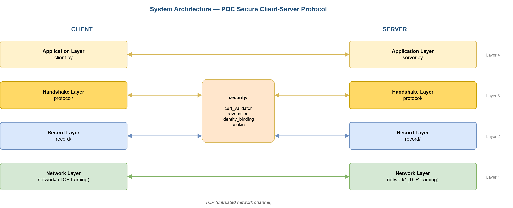
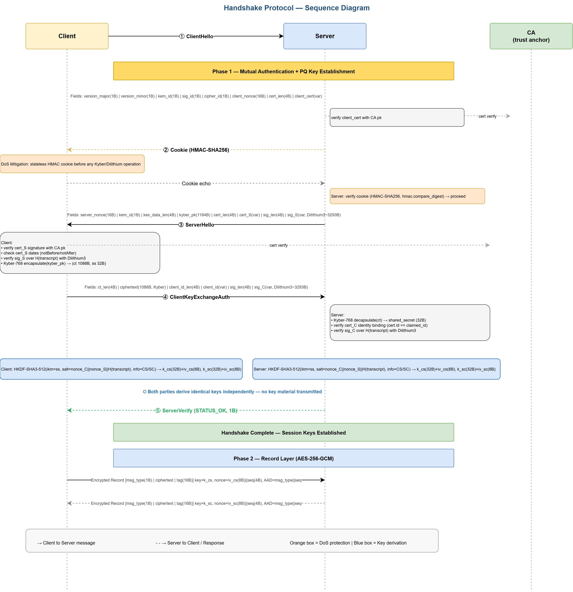

# Kuantum Sonrası (Post-Quantum) Güvenli İstemci–Sunucu Protokolü

> 📌 **Bu depo bir vitrin (showcase) deposudur; projenin kendisi değildir.**
> Burada projenin tanıtımı, teknik raporu, mimari diyagramları ve deney sonuçları yer alır. **Kaynak kod bu depoda bulunmaz.** Kod ayrı bir private depoda tutulmaktadır ve talep üzerine paylaşılabilir.

Proje, gizlilik, bütünlük ve karşılıklı kimlik doğrulama sağlayan ve hem klasik hem de kuantum çağı saldırılarına karşı dayanıklı olması hedeflenen bir istemci–sunucu iletişim protokolünün tasarımını, gerçeklemesini ve deneysel değerlendirmesini kapsar. Protokol TLS 1.3'ten esinlenmiştir ve NIST tarafından standartlaştırılan ML-KEM (Kyber) ve ML-DSA (Dilithium) algoritmalarını kullanır.

**Geliştiriciler:** F. Zehra Ateş ve Zeynep Özçelik · Haziran 2026

📄 **Teknik rapor:** [`docs/PQC_Final_Report_v2.pdf`](docs/PQC_Final_Report_v2.pdf)

> ⚠️ Proje bir **araştırma prototipidir**, üretim ortamı için tasarlanmamıştır.

---

## 🎯 Öne Çıkanlar

- Üç çalışma modu: **PQ_ONLY**, **CLASSICAL** ve **HYBRID** (X25519 + Kyber-768)
- Kanonik ikili kodlama ve transkript bağlama ile TLS 1.3 esinli handshake
- Stateless HMAC çerezi ile temel DoS azaltma
- AES-256-GCM record katmanı: replay penceresi, otomatik rekeying, fail-closed davranış
- Sertifika doğrulama (imza, tarih, kimlik bağlama) ve temel CRL desteği
- 100 denemelik performans ölçümleri ve istatistiksel anlamlılık testleri
- 6 saldırı tipi × 3 mod simülasyonu ve 34 testlik test paketi

---

## 🔐 Kriptografik Tasarım

| Bileşen | Algoritma |
|---|---|
| Anahtar değişimi (PQ) | CRYSTALS-Kyber768 (ML-KEM-768) |
| Dijital imza (PQ) | CRYSTALS-Dilithium3 (ML-DSA-65) |
| Klasik anahtar değişimi / imza | X25519 / Ed25519 |
| Simetrik şifreleme | AES-256-GCM |
| Anahtar türetme | HKDF (SHA3-512) |
| Transkript özeti | SHA3-512 |

### Çalışma Modları

| Mod | Anahtar Değişimi | Kimlik Doğrulama | Kuantuma Dayanıklı | Kullanım Amacı |
|---|---|---|---|---|
| `PQ_ONLY` | Kyber-768 | Dilithium-3 | Evet | Tam PQ dağıtım |
| `CLASSICAL` | X25519 | Ed25519 | Hayır | Performans referansı |
| `HYBRID` | X25519 + Kyber-768 | Dilithium-3 | Evet (biri bozulmasa yeter) | Geçiş dönemi |

Üç mod aynı handshake durum makinesini, aynı record katmanını ve aynı sertifika altyapısını paylaşır; yalnızca kriptografik sağlayıcılar değişir. Sertifikalar mod ne olursa olsun Dilithium ile imzalanır.

---

## 📐 Mimari

| Katman | Sorumluluk |
|---|---|
| Uygulama | Giriş noktaları, mod seçimi |
| Handshake | Mesaj kodlama, transkript, durum makineleri |
| Record | AES-256-GCM, anahtar çizelgesi, replay penceresi, rekeying |
| Taşıma | TCP çerçeveleme (4 baytlık uzunluk öneki) |

Ek bir güvenlik modülü (sertifika doğrulama, iptal kontrolü, kimlik bağlama, DoS çerezi) anahtar malzemesi oluşmadan önce gerekli kontrolleri yürütür.

### Handshake (7 adım)

1. **ClientHello:** sürüm, algoritma kimlikleri, istemci nonce'u, sertifika
2. **Çerez değişimi:** pahalı işlemlerden önce stateless HMAC-SHA256 çerezi
3. **ServerHello:** sunucu nonce'u, KEM açık anahtarı, sertifika, Dilithium imzası
4. **Doğrulama ve KEM kapsülleme:** sertifika, tarih ve imza kontrolleri
5. **ClientKeyExchangeAuth:** KEM şifreli metni ve istemci kimliği, transkript özetiyle birlikte imzalanır
6. **Anahtar türetme:** iki taraf da bağımsız olarak aynı yön başına anahtarları türetir
7. **ServerVerify:** istemci sertifikası ve kimlik bağlaması doğrulanır, KEM açılır

### Record Protokolü

- AES-256-GCM, nonce: `iv_base (8 bayt) || seq_num (4 bayt)`
- AAD: `msg_type || seq_num`
- Yön başına 64 boyutlu IPsec tarzı replay penceresi
- Her 10.000 kayıtta bir HKDF-SHA3-512 ile rekeying
- Güvenlik ihlalinde soket kapatılır (fail-closed)
- Kayıt başına sabit 21 bayt ek yük

---

## 🛡️ Tehdit Modeli

Saldırgan kanalı tamamen kontrol edebilir: dinleyebilir, mesajları değiştirebilir veya enjekte edebilir, eski verileri tekrar oynatabilir ve MITM saldırısı deneyebilir. Temel kriptografik ilkellerin kırılmadığı ve meşru tarafların uzun vadeli özel anahtarlarının başlangıçta saldırgan elinde olmadığı varsayılır. Yan kanal ve kapsamlı DoS saldırıları kapsam dışıdır.

---

## 📊 Performans Sonuçları

Yerel (localhost) TCP üzerinde, Python prototipi ile 100 deneme:

| Konfigürasyon | Ortalama (ms) | Medyan (ms) | P95 (ms) |
|---|---|---|---|
| `CLASSICAL` (X25519 + Ed25519) | 37.2 | 34.0 | 55.4 |
| `PQ_ONLY` (Kyber768 + Dilithium3) | 131.2 | 122.3 | 202.2 |
| `HYBRID` (X25519 + Kyber768 + Dilithium3) | 127.3 | 119.6 | 199.3 |

- `PQ_ONLY`, `CLASSICAL`'a göre medyanda yaklaşık 3,5 kat yavaştır.
- `HYBRID` ile `PQ_ONLY` arasında istatistiksel olarak anlamlı fark gözlenmemiştir (Mann-Whitney p = 0,568).
- Kyber512/768 ve Dilithium2/3 karşılaştırmalarında Python prototipinde anlamlı gecikme farkı çıkmamıştır.
- Record katmanı 64 KB yüklerde yaklaşık 2,7 GB/s şifreleme verimine ulaşır.

> **Not:** Süreler Python yorumlayıcı yükünden etkilenir ve C tabanlı gerçeklemelerle doğrudan karşılaştırılamaz. Ölçümler iki farklı makinede alınmıştır; mod karşılaştırmalarının tek makinede tekrarlanması önerilir.

Ham sonuçlar: [`results/`](PQ_result/)

---

## 🧪 Güvenlik Değerlendirmesi

6 saldırı tipi × 3 mod × 30 deneme (toplam 540 deneme):

| Saldırı | Açıklama |
|---|---|
| Replay | Yakalanan şifreli kayıtların yeniden gönderilmesi |
| Bit-flip | Şifreli metnin yolda değiştirilmesi |
| Sahte sunucu | Meşru sunucunun taklit edilmesi |
| Downgrade | Geçersiz algoritma kimliği enjekte edilmesi |
| Eavesdrop | Pasif trafik dinleme |
| MITM | Aktif araya girme |

Tüm denemelerde saldırılar başarısız olmuş, yanlış pozitif gözlenmemiştir. Bu sonuçlar **tanımlı tehdit modeli ve test senaryoları kapsamında** geçerlidir. Pasif saldırılarda "tespit" yerine saldırganın veriyi çözememesi anlaşılmalıdır. Test paketi 10 modül ve 34 testten oluşur; kriptografik işlemler taklit edilmeden gerçek algoritmalarla çalıştırılır.

---

## ⚠️ Sınırlılıklar

- Tek, sabitlenmiş CA anahtarına dayalı güven modeli
- Elle güncellenen yerel CRL; otomatik dağıtım veya OCSP yok
- DoS koruması yalnızca HMAC çerezi ile sınırlı (SYN flood, hız sınırlama vb. kapsam dışı)
- Yan kanal analizi ve sistematik fuzzing yapılmamıştır
- Tek protokol sürümü; sürüm pazarlığı yok
- Replay penceresi TCP için tasarlanmıştır

---

## 🔑 Kaynak Koda Erişim

Kaynak kod private bir depoda tutulmaktadır. Değerlendirme veya inceleme amacıyla erişim talep edebilirsiniz; GitHub kullanıcı adınızı ileterek depoya davet edilebilirsiniz.

🔗 **LinkedIn:** [F. Zehra Ateş](https://www.linkedin.com/in/zehrates/) · [Zeynep Özçelik](https://linkedin.com/in/zeynep-ozcelik-)

---

## 📜 Lisans

Bu depodaki dokümantasyon ve görseller, yazarların izni olmadan çoğaltılamaz. Kaynak kodun lisansı (MIT) ayrı depoda belirtilmiştir.
